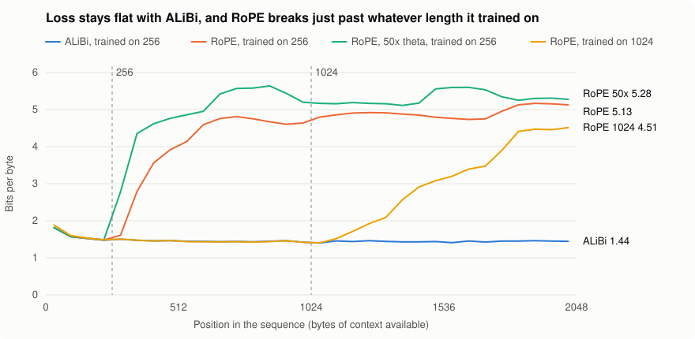
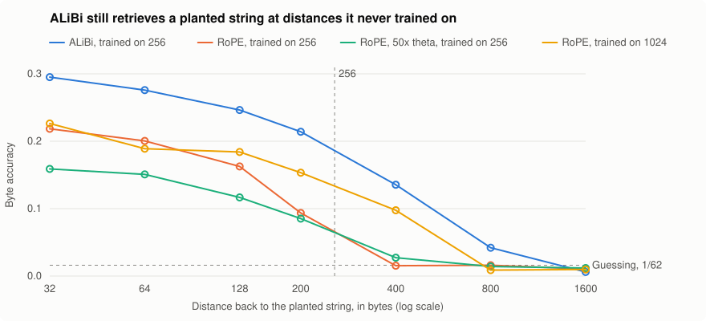

# mai

**Testing mathematical changes to deep learning, under rules that let the ideas fail.**

Every idea here gets a derivation, a numeric check, a kill criterion written before any run, and a comparison against
equally tuned baselines on paired seeds. Everything stays in the repo, including the ideas that died and the mistakes I
made along the way.

**8 hypotheses** &nbsp;·&nbsp; **8 experiments** &nbsp;·&nbsp; **5 literature notes** &nbsp;·&nbsp; **2 experiments on real GPUs**

## The headline

**A byte-level transformer that predicts text at 1.48 bits per byte collapses to about 5 once it reads past its training
length. I traced that collapse from a suspected bug to a measured mechanism, and one change removes it.**



- **It is not a bug.** With far columns removed, long rows match truncated input exactly (1.488 and 1.488), and a model
  trained at 1024 works at 1024.
- **The break follows the training length.** The same RoPE setup breaks just past 256 when trained at 256, and just past 1024
  when trained at 1024.
- **Attention moves to distances the model never saw.** At twice the training length, each unseen-distance token gets **22
  times** the weight of a seen in-range distractor. At 8x, 93% of attention mass is on unseen distances.
- **Raising RoPE's `theta` 50x makes it worse,** which refutes the wraparound explanation I first proposed.
- **ALiBi holds flat to 8x training length,** with no cost at short context (1.475 against 1.480). It ties a RoPE model trained
  at 1024 on identical targets (1.421 against 1.419), without ever training past 256.
- **ALiBi still retrieves past its training length,** where RoPE trained on the same length is at chance.



> **How far to trust this.** This is a toy run: 2 seeds, 6000 steps, 18 minutes on one RTX 5090. The effects are large and appear
> in both seeds, but my [pre-registration](hypotheses/H8_long_context_failure.md) says a toy run sets a direction only, and any
> claim about a cause or fix needs the full run. ALiBi also both removes RoPE and adds decay, so this cannot yet say which of
> those matters. [Full results](experiments/E8_long_context/RESULTS.md).

**The bottom line across the whole project:** no new method of mine has beaten a tuned baseline so far. What I have
is verified mathematics, clear negative results, and a diagnosis that makes the next comparison possible.

## Top findings

| # | Finding | Key number | Evidence |
|---|---|---|---|
| 1 | The long-context collapse is not a bug, and it follows the training length | 22x weight on unseen distances | Toy, 2 seeds |
| 2 | ALiBi survives to 8x training length with no short-context cost | 1.44 against 5.13 bits per byte at 8x | Toy, 2 seeds |
| 3 | A closed-form attention temperature is correct, and still loses | Lost by 0.034 to 0.065 in accuracy | 5 seeds, pre-registered kill |
| 4 | Plain entmax-1.5 is strongest on synthetic recall | +0.08 accuracy over softmax | 5 seeds, not the planned test |
| 5 | Swapping in a sparse readout after training is costly | +0.26 bits per byte, all 4 seeds | Real text, descriptive |
| 6 | Adam's epsilon has an exact recursion, and is not an effective-LR schedule at equilibrium | Identities hold to 1e-14 | Exact, then a toy model |
| 7 | Sign updates give forward gradients no estimator advantage | 2.47x as many samples needed | Closed form and Monte Carlo |
| 8 | A prior-art search retired a hypothesis before any compute was spent | 93.7-97.1% of modes below the edge | Literature |

### 1. Why long contexts collapse

This came from the failure of [H7](experiments/E7_gpu/RESULTS.md), where every attention normalizer broke at 2x training length, so
that experiment could not test its question. The published effect is far smaller (about +0.45 bits at 2x in 2601.15380, against my
+2.4 to +3.8), so I built [H8](hypotheses/H8_long_context_failure.md) to be able to catch a bug, not just to confirm a story.

| Setup | L(256) | L(512) | L(1024) | L(2048) | Far over near, per token |
|---|---|---|---|---|---|
| RoPE, `theta = 10000` | 1.480 | 3.918 | 4.637 | 5.128 | 22.05 |
| RoPE, `theta = 500000` | 1.486 | 4.764 | 5.199 | 5.277 | 27.88 |
| ALiBi | 1.475 | 1.464 | 1.421 | 1.444 | 0.25 |
| RoPE, trained at 1024 | 1.486 | 1.466 | 1.419 | 4.513 | 0.38 |

Mean logit relative to the row's top is -13.7 at distances 64 to 256, then about -10 at every range beyond, with no recurring peak at
this resolution. So unseen distances simply sit about 4 nats above seen distractors, and enough of them swamp the signal. That
training pushes the seen distractors down is my reading, and it is not yet tested.

### 2. A closed-form attention temperature that is right, and still loses

Treating a softmax row as a Random Energy Model with one relevant token gives the smallest inverse temperature that puts a target mass
on that token:

```
beta* = (mu - sqrt((mu^2 - 2 sigma^2 L)_+)) / sigma^2,    L = log n + kappa
```

- **Correct for Gaussian scores:** above threshold at `n >= 2^10`, needle mass missed its 0.9 target by at most 0.013.
- **Broken by heavy tails:** at `n = 2^18`, mass falls to 0.000 for Laplace scores at signal ratio 1.05, and for Student-t (3 df) at 2.0.
- **Lost as attention at every noise level:** trained at `N = 8` and tested to `N = 256`, by 0.034 to 0.065 in accuracy at noise 0.6 and
  0.9, and by 0.006 to 0.015 at noise 0. It ties learned SSMax at `N = 256` with no learned parameters.
- **Holding mass up is not enough:** at noise 0.6 and `N = 256`, entmax-1.5 and REM have nearly equal mass (0.60 and 0.59), but accuracies
  of 0.814 and 0.749.

[E1.0](experiments/E1_0_rem_numeric/RESULTS.md) · [E1.1](experiments/E1_1_recall/RESULTS.md) · [H1](hypotheses/H1_rem_attention_temperature.md).
Synthetic task, 71k parameters.

### 3. Entmax-1.5: the main lead that is still open

At `N = 256` it beat softmax by **+0.077** [+0.049, +0.105] at noise 0.6 and **+0.078** [+0.053, +0.102] at noise 0.9, with no length term.
Learned length scaling did not measurably improve it. Its margin over SSMax is thinner, about +0.035, with no multiplicity correction. On real
text it is close to softmax at training length (-0.0048 bits per byte, about [-0.013, +0.003]) and costs about 29% more per step. Now that
a setup survives past training length, this can finally be tested properly.

### 4. Sparse readouts cannot just be swapped in

Reading a softmax-trained model with entmax-1.5 raises loss at `N = 256` from **1.394 to 1.653 bits per byte**. The cost is 0.243 to 0.267 in all
4 seeds, at a length where the model works, with no recalibration. So this rules out the naive version only.
[E7](experiments/E7_gpu/RESULTS.md).

### 5. Adam's epsilon

Finite epsilon does not break closure of the scale-free AdamW dynamics. It adds one schedule input, `E_t = eps eta_t / a_t`, and gives a crossover
scale:

```
D_i        = sqrt(v_i) + E_t / Psi_t
p_i        = m_i / D_i
N_t        = ||u_t - Psi_t p_t||
Psi_{t+1}  = B~_t Psi_t / N_t
r*         = G / (eps sqrt(d))
```

This extends the epsilon-free schedule law of 2609.09116, which lists finite epsilon as open. The exact identities hold to about 1e-14, including
against real `torch.optim.AdamW`. On a noise walk, equilibrium rotation stayed at 3.24e-3 while `r` moved from 2.22 to 0.20, which refutes my
stronger conjecture. The relaxation formula missed by 18.8% against a 15% limit, so the kill fired and the real-network test was not run. Five
searches did not find this crossover law, which is weak evidence that it is new. [E4.0](experiments/E4_0_epsilon_law/RESULTS.md) ·
[H4](hypotheses/H4_adam_epsilon_schedule_law.md).

### 6. Forward gradients

For a fixed gradient, signal-to-noise per unit gradient is 1 for raw updates, `sqrt(2/pi) = 0.80` when tangent-normalized, and `2/pi = 0.64` for sign
updates, so about `pi^2/4 = 2.47` times as many samples for the same accuracy. Effects in training are untested.
[E3.0](experiments/E3_0_forward_gradient_snr/RESULTS.md).

### 7. Checking prior art first

I retired my noise-edge gate for Muon before running it. BulkBoost (2610.07497) already has the half-batch noise estimator and the Marchenko-Pastur edge,
and reports that *boosting* below-edge modes helps. Spectrally Targeted Muon (2610.10965) reports that top-only orthogonalization falls short.
[The search log](notes/lit/prior_art_H1_H2.md) records what I did not search, and how deeply I read each paper.

## All hypotheses

| ID | Question | Status | Record |
|---|---|---|---|
| H1 | Does a REM closed form set attention temperature? | **Killed** | [hypothesis](hypotheses/H1_rem_attention_temperature.md), [E1.0](experiments/E1_0_rem_numeric/RESULTS.md), [E1.1](experiments/E1_1_recall/RESULTS.md) |
| H2 | Does gating Muon at a noise edge help at small batch? | **Retired on prior art**, not tested | [hypothesis](hypotheses/H2_noise_edge_spectral_gate.md), [prior art](notes/lit/prior_art_H1_H2.md) |
| H3 | Do sign updates improve forward-gradient estimates? | **No estimator advantage**, training not tested | [E3.0](experiments/E3_0_forward_gradient_snr/RESULTS.md) |
| H4 | Does Adam's epsilon act as an effective-LR schedule? | **Stopped**, kill fired | [hypothesis](hypotheses/H4_adam_epsilon_schedule_law.md), [E4.0](experiments/E4_0_epsilon_law/RESULTS.md) |
| H5 | Does entmax's gain come from training or from readout? | **Launched, result not recorded** | [hypothesis](hypotheses/H5_sparsity_train_or_inference.md), [E5.1](experiments/E5_1_swap/RESULTS.md) |
| H6 | In diagonal nets, is decay-then-off the same as a small init? | **Launched, partly read** | [hypothesis](hypotheses/H6_decay_budget_vs_small_init.md), [E6.0](experiments/E6_0_decay_budget/RESULTS.md) |
| H7 | Do attention normalizers help long contexts on real text? | **Ran, did not test its question** | [hypothesis](hypotheses/H7_gpu_attention_on_real_text.md), [E7](experiments/E7_gpu/RESULTS.md) |
| H8 | Why do models break past training length? | **Toy run done: not a bug, ALiBi holds.** Full run pending | [hypothesis](hypotheses/H8_long_context_failure.md), [E8](experiments/E8_long_context/RESULTS.md) |

[LEDGER.md](LEDGER.md) has the evidence for each, plus the queue of ideas not yet pre-registered.

## How I work

1. **Falsifiable first.** Each hypothesis states its mechanism, prediction, baseline and kill criterion before any run. Pre-registrations change only through
   dated amendments, made before the data they affect.
2. **Derive before training.** A formula gets a derivation or numeric identity check first.
3. **Equal tuning.** A win against an untuned baseline does not count.
4. **Paired seeds and spread.** No single-seed claims. H7 applies a Holm correction to its primary tests.
5. **Controls that can catch me.** H8 has a positive control and a truncated-input check, because the obvious explanation could have been wrong. It was, in part.
6. **Negative results stay.** A killed hypothesis keeps its entry and its reason.
7. **Prior art is searched and logged,** including what I did not search.

### Mistakes I found and kept on the record

- **My wraparound explanation for E7.** A higher `theta` should have helped. It made things worse.
- **E7's positional design.** I fixed RoPE at `theta = 10000` and tested normalizers on top of a failure I had not checked for. Measuring loss per row first would have caught it.
- **E7's copy probe.** Every probe input was 2048 bytes long, so even short distances ran in the failing regime. E8 fixes this.
- **E7's first run.** It was lost when the instance was destroyed before the results were copied. Results now print on screen, and that run is not used anywhere.
- **H8's first reading rules.** A long-row bug could have read as "survives", because it raises both losses in a comparison. Review caught this before any real run, and I recorded the fix as an amendment.
- **E1.2's kill criterion.** It fires by construction, because SSMax's `beta` is exactly `c log n`, so it carries little information.
- **E1.1's Calib arm.** It failed to bootstrap, so it does not test the question I added it for.
- **E5.1's design.** A both-layer swap changes the cross-attention scores too. I caught this before any run and amended the primary measure.

## Repository map

| Path | Contents |
|---|---|
| [`LEDGER.md`](LEDGER.md) | Every hypothesis, its status and its evidence, plus the idea queue |
| [`hypotheses/`](hypotheses/) | Pre-registrations, with derivations and amendments |
| [`experiments/`](experiments/) | One folder per experiment: code, recorded output and `RESULTS.md` |
| [`src/mai/attention.py`](src/mai/attention.py) | Attention normalizers: softmax, SSMax, entmax-1.5, scaled entmax, REM, Calib |
| [`tests/`](tests/) | Tests for the normalizers, the readout swap and both GPU pipelines |
| [`notes/lit/`](notes/lit/) | Literature surveys with paper IDs and reading depth |
| [`docs/figures/`](docs/figures/) | The figures above, drawn from the CSV by [`make_figures.sh`](experiments/E8_long_context/make_figures.sh) |
| [`STATE.md`](STATE.md) | Working state for resuming the research |

## Reproducing

Requires Python 3.9+, `torch >= 2.3`, `numpy` and `scipy`. The tests have their own runners. A [GitHub Actions workflow](.github/workflows/tests.yml), started by hand, runs them all plus a small E8 run. Its last run, at `bb4635f`, the commit that produced the E8 results, passed.

```bash
python tests/test_e8.py
```

The toy run behind the headline, on one GPU. It checks the machine, downloads enwik8, resumes if rerun, and prints its report:

```bash
bash experiments/E8_long_context/run.sh --toy --per-gpu 4
```

The full version of the same experiment, with 5 setups and 3 seeds:

```bash
bash experiments/E8_long_context/run.sh
```

The real-text normalizer comparison:

```bash
bash experiments/E7_gpu/run.sh
```

The numeric checks are standalone scripts, for example:

```bash
python experiments/E1_0_rem_numeric/check.py
```

Recorded runs used Colab CPU, except E7 (4x RTX 5090) and E8 (1x RTX 5090), both on rented machines. Implementation and analysis were done with Claude as a coding agent, which is
why commits show it as a co-author. Reviews marked independent came from a separate agent that had not seen my reasoning.

## Limits of this evidence

- **E8 is a toy run.** Two seeds and a third of E7's training set a direction only. Step times there are not clean, because workers shared the GPU.
- **E1 to E6 are small synthetic or toy problems,** so their rankings may not transfer to language models.
- **E7's useful results come only from `N = 256`,** with one positional scheme and 4 seeds. All its arms selected the top of the learning-rate grid, as did E1.1.
- **One dataset and one model size** on real text, with softmax only in E8.
- **Some paper numbers come from AI-generated summaries,** not the PDFs. The notes mark each one, and they should be rechecked before being cited.

## What is next

1. **Run E8 in full.** It adds RoPE plus ALiBi, which separates "RoPE breaks" from "decay rescues", and it turns the direction above into a claim.
2. **Compare normalizers on a setup that survives,** with fresh seeds. This is the test H7 could not run, and it decides the entmax lead.
3. **Read out H5 and H6,** rerunning them if their files are gone.
4. **Try different mathematics.** Candidates from the surveys are 1-D Wasserstein logit losses and how contrastive temperature should scale with the number of negatives.

## License

[MIT](LICENSE)
